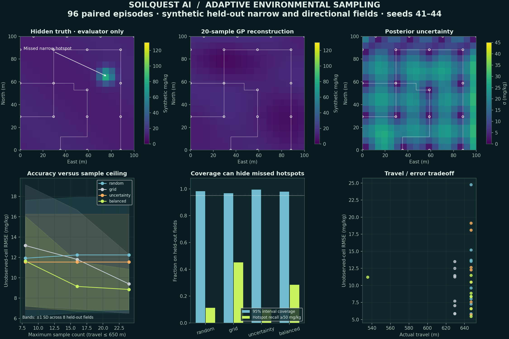
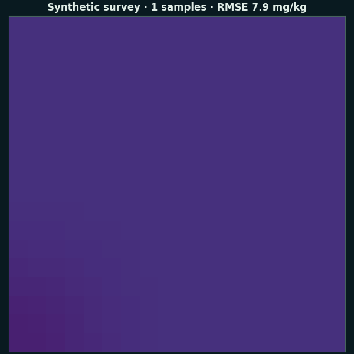
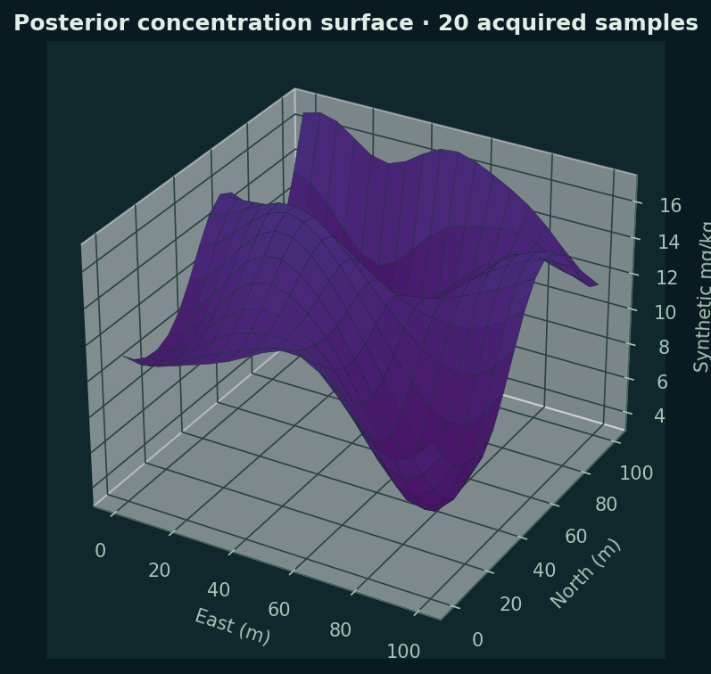

# Problem Statement

[](https://github.com/mirmoosa1014-rgb/soilquest-ai/actions/workflows/ci.yml)

**Where should a limited environmental survey sample next?** SoilQuest AI is a local, synthetic environmental sampling laboratory that compares spatial reconstruction accuracy and hotspot detection under explicit sample and robot-travel budgets. It takes a generated field family, seed, policy and budgets, then returns noisy acquired samples, a Gaussian-process reconstruction, uncertainty, obstacle-aware paths and a complete decision audit.

Success is measured by unobserved-cell RMSE/MAE, hotspot precision/recall and interval coverage at equal resource ceilings. The purpose is to test sampling decisions, not infer actual heavy metals from camera images. Every concentration, field and laboratory-like observation is synthetic.



**[Experiment data](results/benchmark.csv) · [Model card](docs/model.md) · [Evaluation protocol](docs/evaluation.md) · [90-second demo](docs/demo.md)**

## An interactive field notebook

The interface follows a warm documentary journal: geographic reconstruction, margin notes, a sample ledger and an evaluator’s section. [Design and motion record](docs/design.md). Updated screenshots are generated by the Linux browser verification workflow; the earlier interface captures are retained only as historical files.

- Five seeded spatial families: smooth plume, multiple sources, background, directional transport-shaped field and a narrow-hotspot stress case.
- Observation-only Gaussian-process reconstruction with an 18 m length scale trained on separate field families.
- Four paired policies: random, regular 5 × 5 grid, uncertainty sampling and balanced exploration/exploitation.
- A large geographic reconstruction, uncertainty margin study, actual sample ledger, step-by-step acquisition replay, four-policy comparison and rotatable 3D concentration surface.
- Four-connected shortest paths around obstacles, charged metre by metre against a 650 m travel ceiling.
- Ground truth in an explicitly separated evaluator pane, plus complete JSON audit export.



## Run locally

Requires Python 3.12+ and Node.js 24. No paid services, cloud account, GPU or hardware. Install dependencies once, then the demo works offline. Run commands from this project directory.

```sh
python3 -m venv .venv
.venv/bin/python -m pip install -r requirements.lock
cd frontend
npm ci
npm run build
cd ..
./run.sh
```

Open **http://127.0.0.1:8104**. The API and bundled frontend share this loopback address. On Windows, use `.venv\Scripts\python` in place of `.venv/bin/python` and start `python -m uvicorn soilquest.api:app --host 127.0.0.1 --port 8104`.

For frontend development, keep the API on port 8104 and run `npm run dev --prefix frontend`. Vite proxies `/api` requests to the local backend. No external map tiles, fonts or hosted APIs are required.

## Reproduce and verify

```sh
.venv/bin/python -m pytest -q
.venv/bin/python scripts/train.py
OPENBLAS_NUM_THREADS=1 .venv/bin/python scripts/benchmark.py --quick
OPENBLAS_NUM_THREADS=1 .venv/bin/python scripts/benchmark.py
.venv/bin/python scripts/visualize.py
npm run build --prefix frontend
cd frontend
npx playwright install chromium
npm run test:browser
```

Browser tests launch the local server automatically when needed. Quick mode evaluates eight episodes; the fuller bounded benchmark evaluates 96 and regenerates the representative data. `scripts/visualize.py` uses the full benchmark output. All outputs remain small enough for source review.

## Measured findings

The fuller benchmark uses eight completely held-out fields (narrow/directional families, seeds 41–44), three sample ceilings and four policies. All share potential noisy cell measurements, initial sample and travel ceiling. Actual sample counts differ when travel is exhausted.

| Policy | RMSE mg/kg | Hotspot recall | Mean samples | Travel m |
|---|---:|---:|---:|---:|
| Random | 12.25 | 11.3% | 10.00 | 647.1 |
| Regular grid | 9.40 | 45.2% | 24.00 | 629.4 |
| Uncertainty | 11.57 | 10.3% | 7.00 | 647.1 |
| Balanced | 8.86 | 28.5% | 22.25 | 633.1 |

Values above use the 24-sample ceiling and 650 m travel ceiling. Balanced reduces average reconstruction error in this small benchmark, while the regular grid detects more hotspots. This is a useful tradeoff, not evidence that one method always wins. High interval coverage can coexist with very poor hotspot recall. The default narrow-hotspot example deliberately shows a missed hotspot.



## Scope and assumptions

The generator is a stochastic spatial construction with diffusion-shaped Gaussian sources, not a validated soil transport PDE. Its fictional mg/kg values and 50 mg/kg hotspot threshold carry no regulatory meaning. The GP sees acquired samples only; the evaluator uses hidden truth after decisions. Algorithms are bounded to 324 grid cells and at most 40 acquired samples. The route does not require return to base. Posterior intervals are model-based and not calibrated for real agricultural soils.

This software cannot detect actual heavy metals, identify chemical species, certify land quality or replace real laboratory measurements. Synthetic validation does not establish real-world performance.

## Project guide

| Area | Location |
|---|---|
| Field, observations and policies | `soilquest/field.py`, `policy.py` |
| GP and model metadata | `soilquest/model.py`, `models/hyperparameters.json` |
| Simulation and API | `soilquest/simulation.py`, `api.py` |
| Interactive UI | `frontend/src/` |
| Experiment evidence | `results/`, `docs/images/` |
| Architecture and explanations | [Architecture](docs/architecture.md), [Explain simply](docs/explain.md) |
| Validation and recovery status | [Progress](docs/progress.md) |

## Contribution and publication

Moosa supplied the project direction and requirements and may review or modify the results. Codex generated the implementation, tests, analysis graphics and documentation. No actual field measurements, deployment users or awards are claimed. Source and generated evidence were recovered from the retained implementation transcript after the original Mac workspace disconnected; see the progress record for provenance.

This repository distributes the source and research evidence. Run the application locally using the setup instructions; GitHub does not automatically host the running app.

## Technical sources

- [Rasmussen & Williams, *Gaussian Processes for Machine Learning*, chapter 2](https://gaussianprocess.org/gpml/chapters/RW2.pdf): GP regression and conditioning.
- [SciPy `cho_solve`](https://docs.scipy.org/doc/scipy/reference/generated/scipy.linalg.cho_solve.html): Cholesky-based linear solves.


## Repository

[Source and releases](https://github.com/mirmoosa1014-rgb/soilquest-ai) · [Continuous integration](https://github.com/mirmoosa1014-rgb/soilquest-ai/actions)
